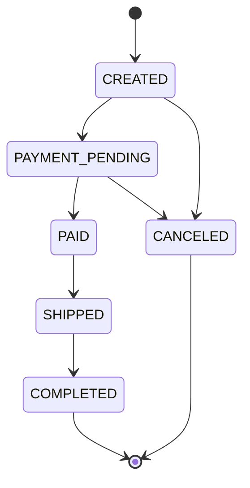

# Marketplace — СОА, домашнее задание №2

REST API маркетплейса на **Go 1.26, стандартном net/http, PostgreSQL 17 и Flyway**. `oapi-codegen` генерирует интерфейс HTTP-обработчиков и все DTO из OpenAPI при сборке. Доступ к БД выполняется через `pgx`, точные денежные расчёты — через `shopspring/decimal`. Реализованы товары, заказы, промокоды, JWT access/refresh, три роли, JSON-логи и транзакционная защита остатков.

Исходное условие: [docs/assignment.md](docs/assignment.md). Подготовка к защите и ответы на 16 вопросов: [docs/DEFENSE.md](docs/DEFENSE.md).

## Запуск

Нужны Docker с Compose и Python 3 для демонстрации и E2E. При сборке через Docker локальные Go и PostgreSQL не нужны.

```bash
docker compose up --build --detach --wait
docker compose logs --tail=80 api
curl -sS http://localhost:8080/actuator/health
```

API доступен на `http://localhost:8080`. PostgreSQL доступен внутри Compose; порт БД наружу не опубликован. Сервис `migrate` запускает Flyway после готовности БД; API стартует только после успешных миграций. Настройка Flyway Maven Plugin находится в `db/flyway-pom.xml`; этот инструмент запускается внутри контейнера миграций. Данные сохраняются в named volume после `docker compose down`.

Для локальной демонстрации создаётся ADMIN: `admin@example.test`, пароль `LocalAdminPass123!`. Саморегистрация поддерживает только USER и SELLER. Эти значения и JWT secret предназначены для локального стенда. Настройки окружения можно задать в `.env`:

| Переменная | По умолчанию / назначение |
|---|---|
| `PORT` | `8080`, порт API на хосте |
| `POSTGRES_PASSWORD` | `marketplace-local-dev`, пароль БД внутри стенда |
| `JWT_SECRET` | локальный ключ из Compose; для другого окружения нужен собственный длинный ключ |
| `BOOTSTRAP_ADMIN_EMAIL` | `admin@example.test` |
| `BOOTSTRAP_ADMIN_PASSWORD` | `LocalAdminPass123!` |
| `ORDER_COOLDOWN_MINUTES` | `1`, целые минуты, отдельно для CREATE_ORDER и UPDATE_ORDER |

Повторный запуск с другим bootstrap-паролем не следует считать сменой пароля существующего пользователя. Access token действует 20 минут, refresh token — 14 дней. В запросах используется `Authorization: Bearer <access_token>`.

## Сборка и проверки

```bash
make generate                         # воспроизводимая генерация OpenAPI
make build                            # генерация контракта и сборка Go-приложения
make test                             # Go unit-тесты
python3 scripts/e2e.py                 # HTTP-сценарии, включая конкурентные запросы
python3 scripts/e2e.py --db-checks     # те же сценарии + проверки PostgreSQL
bash scripts/demo.sh                   # короткое демо с SELECT до и после отмены
```

`make generate`, `make build` и `make test` используют локальный Go, если он доступен; иначе запускают Go 1.26.10 в Docker. Контекст копируется в контейнер, поэтому доступность bind mount не требуется. `make build` создаёт `bin/marketplace` (при Docker-сборке это Linux-бинарник). Путь к локальному инструменту можно указать через `make GO=/путь/к/go build`.

Генерация выполняется командой `go generate ./api`; сгенерированные интерфейсы, структуры и встроенный контракт находятся в `internal/api/generated.go`, который исключён из Git. После генерации локально работают `go test ./...` и `go build -o bin/marketplace ./cmd/marketplace`. Версии зависимостей и генератора закреплены в `go.mod` / `go.sum`. Проверка поведения работающего API — отдельный запуск E2E после старта Compose.

E2E использует только стандартную библиотеку Python и создаёт новые уникальные email, категории и промокоды при каждом запуске. Он не удаляет существующие данные. Каждый ответ проверяется на `X-Request-Id`; ошибочные ответы — на единый JSON-формат. Параллельные клиенты проверяют борьбу за последний товар, один активный заказ, общий лимит промокода и однократное обновление refresh token. Отдельные регрессии проверяют `items: [null]`, дроби вместо integer, неизвестные поля, денежные значения с лишними знаками и предел BCrypt в 72 UTF-8 байта.

`--db-checks` предназначен для локальной учебной БД: помимо `SELECT`, он адресно сдвигает время операций **собственного нового тестового пользователя**, чтобы без ожидания проверить ORDER_HAS_ACTIVE после cooldown; отдельно выключает **собственный новый тестовый промокод** для проверки rollback. В обычном режиме эти два сценария отмечаются `skipped`, остальные выполняются. Данные других пользователей не изменяются. Для ожидаемых проверок 429 оставьте `ORDER_COOLDOWN_MINUTES=1` или больше.

Для другого порта: `API_BASE_URL=http://localhost:8081 python3 scripts/e2e.py`. Учётные данные администратора для тестов задаются через `--admin-email` / `--admin-password` либо `ADMIN_EMAIL` / `ADMIN_PASSWORD`. При `--db-checks` API и Compose должны использовать одну и ту же локальную БД.

Сценарий истечения JWT дополнительно требует `JWT_SECRET` из конфигурации локального стенда. Тест сверяет подпись полученного токена, создаёт подписанный fixture собственного тестового пользователя с прошлым `exp` и проверяет `TOKEN_EXPIRED` / `REFRESH_TOKEN_INVALID`. Часы системы не меняются. Без ключа этот один сценарий отмечается `skipped`. Для неизменённых значений Compose все сценарии запускаются так:

```bash
JWT_SECRET=local-development-only-secret-change-before-deploying-64characters \
  python3 scripts/e2e.py --db-checks
```

Если ключ стенда переопределён, передайте именно его через переменную окружения. Тест не выводит ключ или токены.

## Контракт и маршруты

Источник контракта: [openapi.yaml](api/openapi.yaml), также доступен через `GET /openapi.yaml`. Идентификаторы ресурсов — положительные `int64`, деньги — decimal с двумя знаками, даты — ISO 8601 с часовым поясом. Владелец заказа `user_id` берётся из проверенного JWT. Для товара `seller_id` по умолчанию — текущий пользователь; SELLER может указать только себя, ADMIN может назначить другого существующего SELLER / ADMIN.

| Маршрут | Назначение и доступ |
|---|---|
| `POST /auth/register`, `/auth/login`, `/auth/refresh` | Регистрация, вход, обновление токенов |
| `GET /products`, `GET /products/{id}` | Все авторизованные роли; `page`, `size`, точные фильтры `status`, `category` |
| `POST /products` | SELLER / ADMIN |
| `PUT /products/{id}`, `DELETE /products/{id}` | Свой товар для SELLER; любой для ADMIN |
| `POST /orders` | USER / ADMIN; владелец — текущий пользователь |
| `GET /orders/{id}`, `PUT /orders/{id}`, `POST /orders/{id}/cancel` | Собственный заказ для USER; любой для ADMIN |
| `PATCH /orders/{id}/status` | ADMIN; тело `{"status":"PAYMENT_PENDING"}` |
| `POST /promo-codes` | SELLER / ADMIN |

Все операции CRUD и бизнес-операции требуют access token. `/actuator/health` — техническая проверка готовности. Ошибки имеют поля `error_code`, `message` и необязательный `details`; конкретные HTTP-статусы и error codes описаны в OpenAPI.

## Как устроена бизнес-логика

`Server` реализует сгенерированный `api.ServerInterface` для стандартного `net/http`. Middleware `kin-openapi` проверяет запрос по тому же контракту до обработчика: обязательные поля, enum, типы, диапазоны, размеры массивов и неизвестные поля. JSON декодируется в сгенерированные структуры, дополнительные проверки защищают точность денег и бизнес-инварианты. `pgxpool` управляет соединениями, а Flyway создаёт таблицы, ограничения и индексы. Схема БД дополнительно защищает положительные цены, неотрицательные остатки и лимиты промокодов.

Создание, изменение и отмена заказа выполняются в одной транзакции `pgx.Tx`; общий `inTx` делает commit только при успешном результате, иначе rollback. Блокировки берутся в порядке **пользователь → заказ → товары по возрастанию ID → промокод**. `FOR NO KEY UPDATE` на строке пользователя сериализует параллельные операции даже до появления первого заказа и совместим с блокировкой внешнего ключа. `SELECT … FOR UPDATE` по товарам не позволяет двум заказам потратить один остаток; блокировка промокода защищает `current_uses`. Частичный unique index ограничивает пользователя одним заказом в CREATED / PAYMENT_PENDING. Ошибка откатывает остатки, позиции, промокод и журнал операций; успешная операция получает фактическое время записи через `clock_timestamp()`.

Обновление применяет разницу между старым и новым резервом под теми же блокировками. Это эквивалентно возврату старого резерва и резервированию нового внутри транзакции. Повторяющиеся product_id агрегируются; суммарное количество одного товара ограничено 999. Цена существующей позиции сохраняется из `price_at_order`, новая позиция получает текущую цену товара. Деньги вычисляются через `decimal.Decimal`; `Round(2)` округляет скидку до двух знаков, половину — от нуля (для неотрицательных сумм это `HALF_UP`). SQL NUMERIC читается текстом, без промежуточного float64; денежные поля JSON остаются числами по контракту.



Изменение состава доступно только в CREATED; отмена — в CREATED и PAYMENT_PENDING. `PATCH /orders/{id}/status` нужен для демонстрации последующих переходов и доступен только ADMIN. Переходы проверяются сервисом, прямые перескоки запрещены.

Неоднозначные места условия зафиксированы явно:

* Процент **выше 70** даёт **нулевую скидку**, согласно фразе «в ином случае цена 100%»; ровно 70 допустимо. Промокод при этом считается использованным.
* При обновлении сохраняется snapshot цены уже присутствующих позиций; впервые добавленные товары используют актуальную цену.
* Промокод, уже применённый к заказу, не расходует ещё одно использование при update, даже если `current_uses == max_uses`.
* Падение суммы ниже минимума снимает промокод и освобождает использование. Неактивный или истёкший промокод при update вызывает `PROMO_CODE_INVALID` и полный rollback.
* ADMIN может менять чужие заказы согласно матрице доступа; cooldown учитывается у владельца заказа. SELLER не выполняет операции с заказами.

## Соответствие десяти пунктам

| Пункт | Где показать реализацию | Проверка |
|---|---|---|
| 1. OpenAPI CRUD | `api/openapi.yaml`, `internal/server/products.go` | E2E CRUD, фильтры, пагинация |
| 2. Схемы данных | ProductCreate / ProductUpdate / ProductResponse в контракте | required, enum, decimal, date-time, nullable |
| 3. Кодогенерация | `api/generate.go`, `api/oapi-codegen.yaml`, `internal/api/generated.go` | `make generate`, затем build |
| 4. PostgreSQL / Flyway | `db/migration/V1__marketplace.sql` | SELECT, статус ARCHIVED, индекс status, timestamps |
| 5. Ошибки | OpenAPI ErrorResponse, `internal/server/server.go` | E2E error codes, статусы и конверт |
| 6. Валидация | ограничения OpenAPI, `internal/server/http.go` | границы строк/чисел/массивов, неверные enum и ID |
| 7. Заказы | `internal/server/orders.go`, `internal/server/promos.go` | snapshot, rollback, promo, cooldown, переходы, гонки |
| 8. JSON-логи | middleware в `internal/server/logging.go` | `docker compose logs api`, `X-Request-Id`, маскирование |
| 9. JWT | `internal/server/auth.go` | login/refresh, неверные токены, тип токена |
| 10. Роли | `Principal`, проверки в обработчиках и бизнес-функциях | USER/SELLER/ADMIN, чужие товары и заказы |

Это карта реализации и проверок, а не обещание оценки. На защите нужно самостоятельно объяснить код, запустить систему и показать SQL-запросы; условие отдельно предусматривает снижение оценки при незнании базовой теории.
